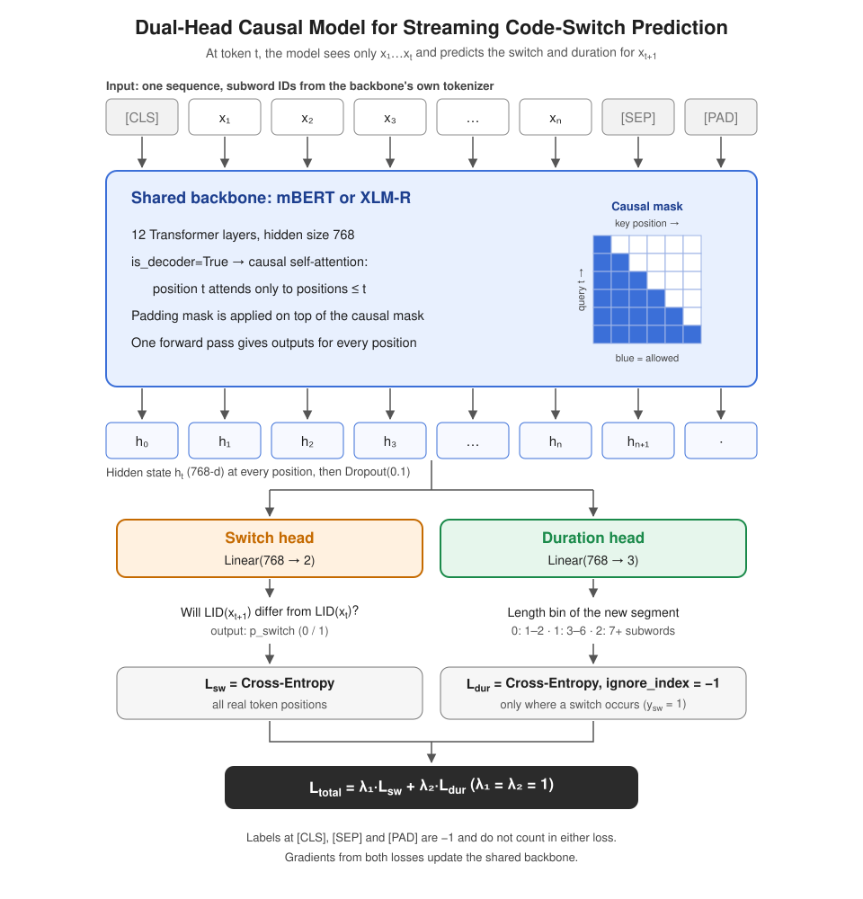

# Project Update 2 — Dual-head causal model

The training code for the dual-head causal model goes here.

Data: [`DATA_V1.1.md`](DATA_V1.1.md) defines data-v1.1 (frozen mBERT and XLM-R tokenizers, re-tokenization, split, where every file is). [`RELABEL_V1_1.md`](RELABEL_V1_1.md) records the Claude relabeling of fr/de/it/philippines; [`data_v1.1_stats.md`](data_v1.1_stats.md) is the statistics table.

## Architecture



A shared mBERT or XLM-R backbone runs with a causal mask (`is_decoder=True`), so the output at token t uses only x_1..x_t.
Two linear heads read the same hidden state h_t: the switch head (768 → 2) and the duration head (768 → 3).
The loss is `L_total = λ1·L_sw + λ2·L_dur`; `L_dur` uses `ignore_index=-1`, so it counts only at true switch positions.
Code: [`model.py`](model.py), [`losses.py`](losses.py). Checks: [`tests/check_causality.py`](tests/check_causality.py), [`tests/check_grad_flow.py`](tests/check_grad_flow.py).

## Contents

| Path | What it is |
|---|---|
| `DATA_V1.1.md`, `RELABEL_V1_1.md` | How data-v1.1 was built; how fr/de/it/philippines were relabeled |
| `IO_STANDARD.md` | What every run writes (`config.json`, `train_log.jsonl`, predictions, metrics) |
| `data.py`, `model.py`, `losses.py` | Collator, dual-head causal model, multitask loss (`ignore_index=-1`) |
| `train.py`, `predict.py`, `evaluate.py` | Training, prediction + threshold tuning, scoring |
| `provenance.py` | Tokenizer/backbone guard and run provenance fields |
| `tests/` | Sanity checks: collator alignment, causality, gradient flow |
| `data_v1.1/` | Text-free data files: per-pair stats and manifests, the shared split |
| `results/<run_id>/` | Every run's config, logs, predictions and metrics (no checkpoints, no text) |
| `figures/` | Architecture diagram, convergence curves, per-pair F1 charts |

## Reproduce Experiment A

The labeled data contains SwitchLingua sentences, so it is not in this repository.
Rebuild it with `DATA_V1.1.md` (or use the team's private copy); `D` below is that folder.

```bash
python -m venv .venv-train && source .venv-train/bin/activate
pip install -r project_update_2/requirements_train.txt   # CUDA build; on CPU, install the same versions without "+cu134"

# 1. Check the frozen tokenizers (must print PASS)
python project_update_2/prepare_tokenizer_v1_1.py --backbone mbert
python project_update_2/prepare_tokenizer_v1_1.py --backbone xlmr

# 2. Train (repeat with --backbone xlmr and the xlmr data)
python project_update_2/train.py --backbone mbert \
    --data D/mbert/combined/labeled_tokens.jsonl \
    --splits project_update_2/data_v1.1/mbert/combined/splits.jsonl \
    --data-tag data-v1.1 --max-len 128 --out project_update_2/runs/<run_id>

# 3. Pick the threshold on validation, then run test once with that threshold
python project_update_2/predict.py --run project_update_2/runs/<run_id> \
    --data D/mbert/combined/labeled_tokens.jsonl \
    --splits project_update_2/data_v1.1/mbert/combined/splits.jsonl \
    --split validation --tune-threshold
python project_update_2/predict.py --run project_update_2/runs/<run_id> \
    --data D/mbert/combined/labeled_tokens.jsonl \
    --splits project_update_2/data_v1.1/mbert/combined/splits.jsonl \
    --split test

# 4. Score (same scorer as the logistic regression baseline)
python project_update_2/evaluate.py --run project_update_2/runs/<run_id> \
    --split validation --data D/mbert/combined/labeled_tokens.jsonl
```

## Results (pooled switch F1)

| Model | Validation | Test |
|---|---|---|
| LR baseline (enhanced) | 59.55% | 59.77% |
| mBERT | 64.49% | 64.14% |
| XLM-R | 63.95% | 64.36% |

Thresholds are chosen on validation only (LR 0.25, mBERT 0.34, XLM-R 0.35); test was run once.
Full metrics: `results/<run_id>/metrics_validation.json` and `metrics_test.json`.