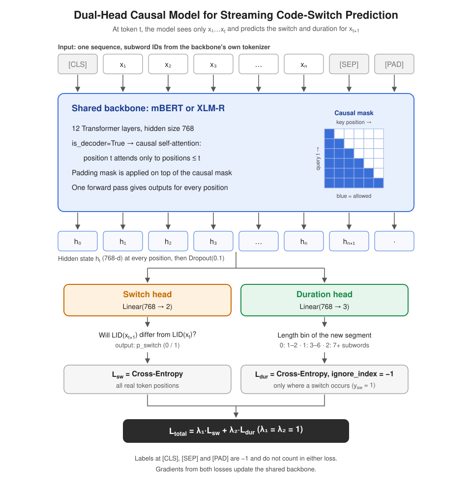

# Project Update 2 — Dual-head causal model

The training code for the dual-head causal model goes here.

Data: [`DATA_V1.1.md`](DATA_V1.1.md) defines data-v1.1 (frozen mBERT and XLM-R tokenizers, re-tokenization, split, where every file is). [`RELABEL_V1_1.md`](RELABEL_V1_1.md) records the Claude relabeling of fr/de/it/philippines; [`data_v1.1_stats.md`](data_v1.1_stats.md) is the statistics table.

## Architecture

A shared mBERT or XLM-R backbone runs with a causal mask (`is_decoder=True`), so the output at token t uses only x_1..x_t.
Two linear heads read the same hidden state h_t: the switch head (768 → 2) and the duration head (768 → 3).
The loss is `L_total = λ1·L_sw + λ2·L_dur`; `L_dur` uses `ignore_index=-1`, so it counts only at true switch positions.
Code: [`model.py`](model.py), [`losses.py`](losses.py). Checks: [`tests/check_causality.py`](tests/check_causality.py), [`tests/check_grad_flow.py`](tests/check_grad_flow.py).
