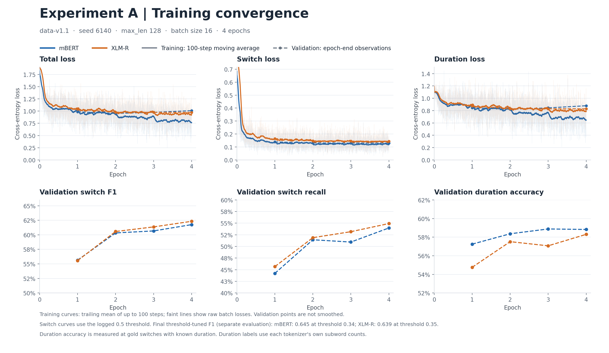

# Experiment A convergence curves

mBERT and XLM-R training/validation curves from the committed Experiment A runs. The figure shows total, switch and duration losses, plus validation switch F1, switch recall and duration accuracy.

- Training losses: trailing 100-step moving average; faint lines show raw batch losses. Initial windows use the available steps.
- Validation: four unsmoothed epoch-end observations per model.
- Switch F1/recall curves use the logged threshold of 0.5. Final validation-tuned F1 values are listed separately in the figure footer.
- Duration accuracy is measured at gold switches with known duration; duration bins use each tokenizer's subword counts.



[PDF version](experiment_a_convergence.pdf)

## Reproduce

Requires Python, NumPy and Matplotlib. From the repository root:

```bash
python3 project_update_2/figures/experiment_a/plot_convergence.py
```

The script reads the existing logs with `git show` at the pinned source commit; no duplicate logs or dataset files are included. Source revision, run IDs, smoothing settings and log hashes are recorded in `plot_manifest.json`.
