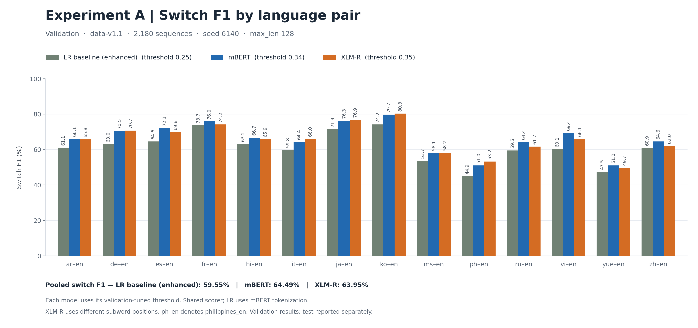
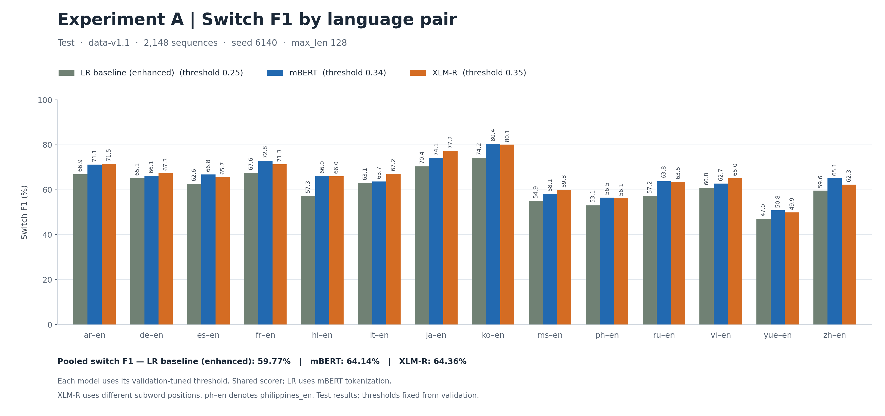

# Experiment A convergence curves

mBERT and XLM-R training/validation curves from the committed Experiment A runs. The figure shows total, switch and duration losses, plus validation switch F1, switch recall and duration accuracy.

- Training losses: trailing 100-step moving average; faint lines show raw batch losses. Initial windows use the available steps.
- Validation: four unsmoothed epoch-end observations per model.
- Switch F1/recall curves use the logged threshold of 0.5. Final validation-tuned F1 values are listed separately in the figure footer.
- Duration accuracy is measured at gold switches with known duration; duration bins use each tokenizer's subword counts.


[PDF version](experiment_a_convergence.pdf)

## Per-pair switch F1

Enhanced LR baseline, mBERT and XLM-R on the 14 data-v1.1 validation language pairs. Each model uses its validation-tuned threshold (0.25 / 0.34 / 0.35). Values come from the verified [comparison table](comparison/README.md). XLM-R uses different subword positions from LR and mBERT.



[PDF](experiment_a_per_pair_f1.pdf) · [SVG](experiment_a_per_pair_f1.svg)

## Reproduce

Requires Python, NumPy and Matplotlib. From the repository root:

```bash
python3 project_update_2/figures/experiment_a/plot_convergence.py
```

The script reads the existing logs with `git show` at the pinned source commit; no duplicate logs or dataset files are included. Source revision, run IDs, smoothing settings and log hashes are recorded in `plot_manifest.json`.

## Test per-pair switch F1

The test chart compares enhanced LR, mBERT and XLM-R on the same 2,148 test sequences. Thresholds remain fixed from validation at 0.25 / 0.34 / 0.35. Transformer test results come from PR #21. Both baseline runs reuse their saved models without retraining or test tuning.



[PDF](experiment_a_per_pair_f1_test.pdf) · [SVG](experiment_a_per_pair_f1_test.svg)

| Model | Fixed threshold | Test switch F1 |
| --- | ---: | ---: |
| Original LR | 0.27 | 57.83% |
| Enhanced LR | 0.25 | 59.77% |
| mBERT | 0.34 | 64.14% |
| XLM-R | 0.35 | 64.36% |

Render the test chart from saved metrics, without running inference:

```bash
python3 project_update_2/figures/experiment_a/plot_per_pair.py --split test
```
